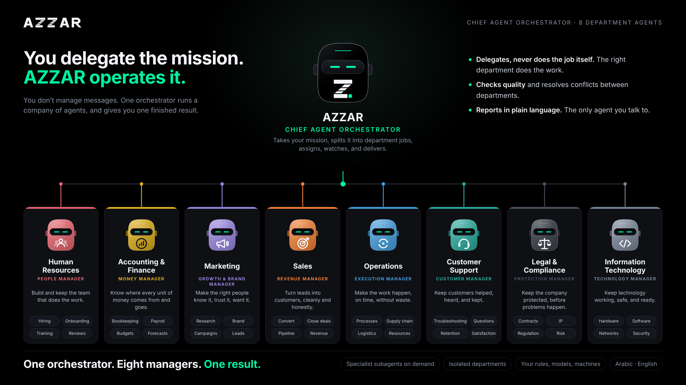
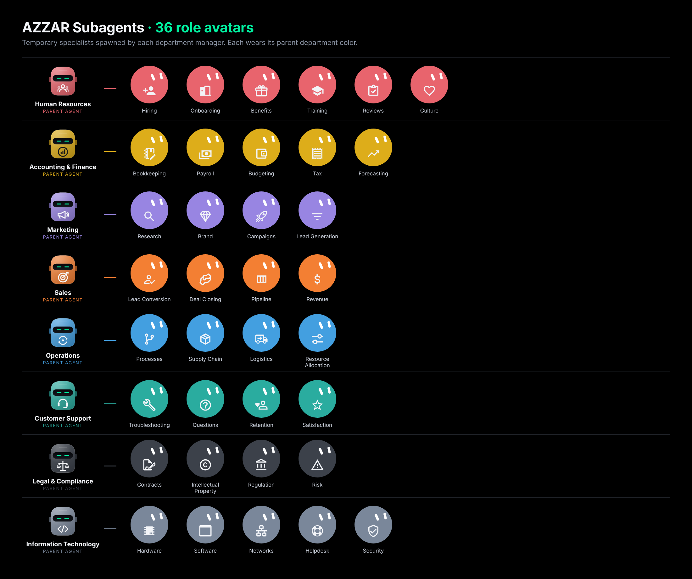
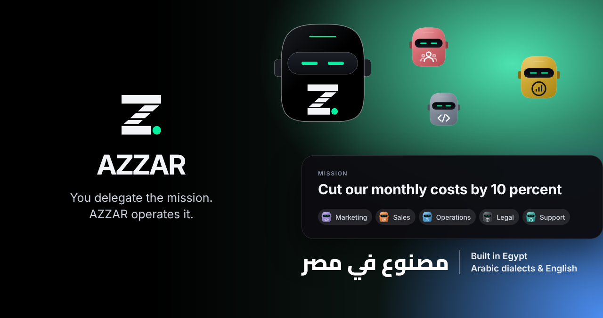
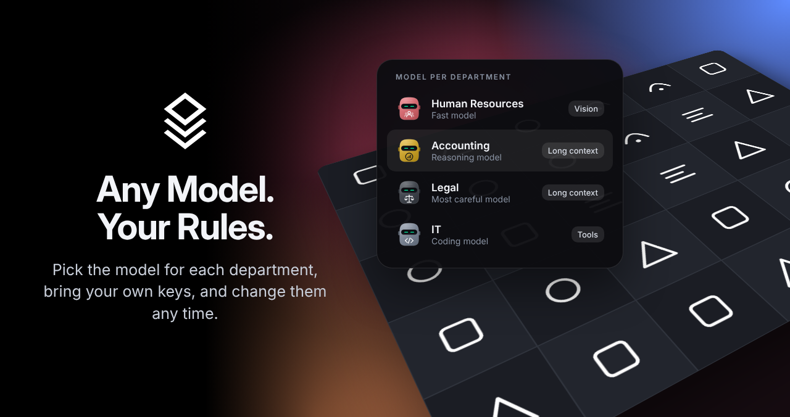
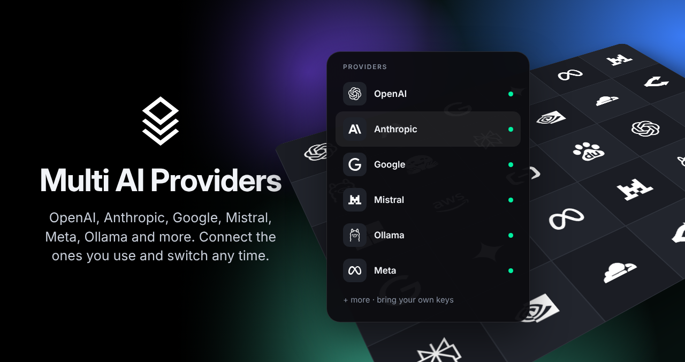
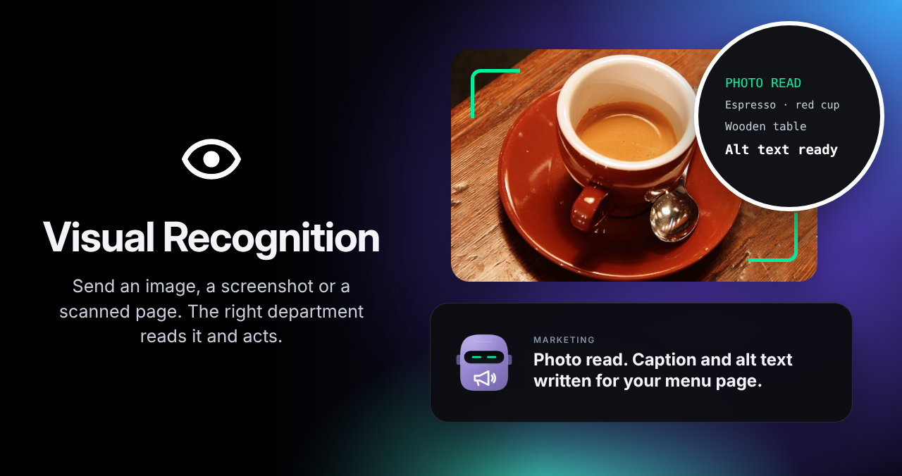
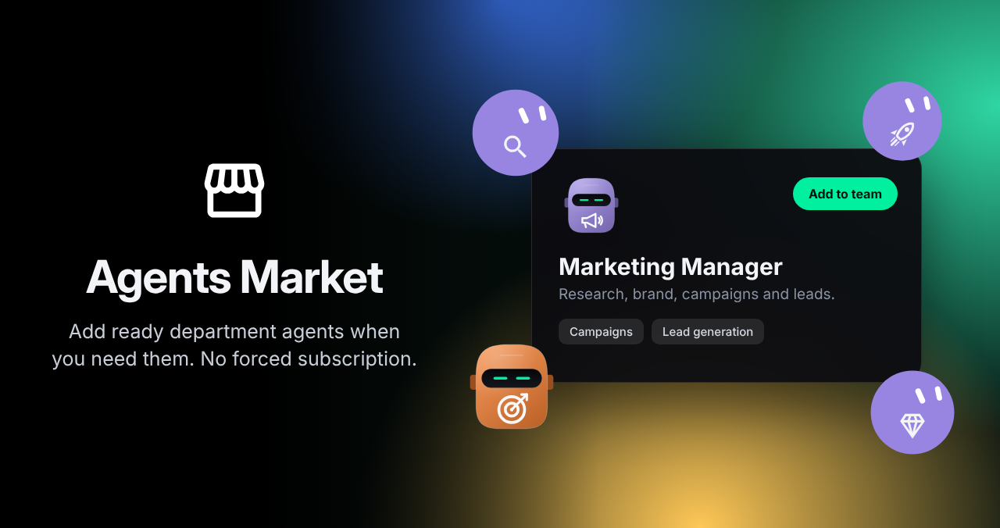
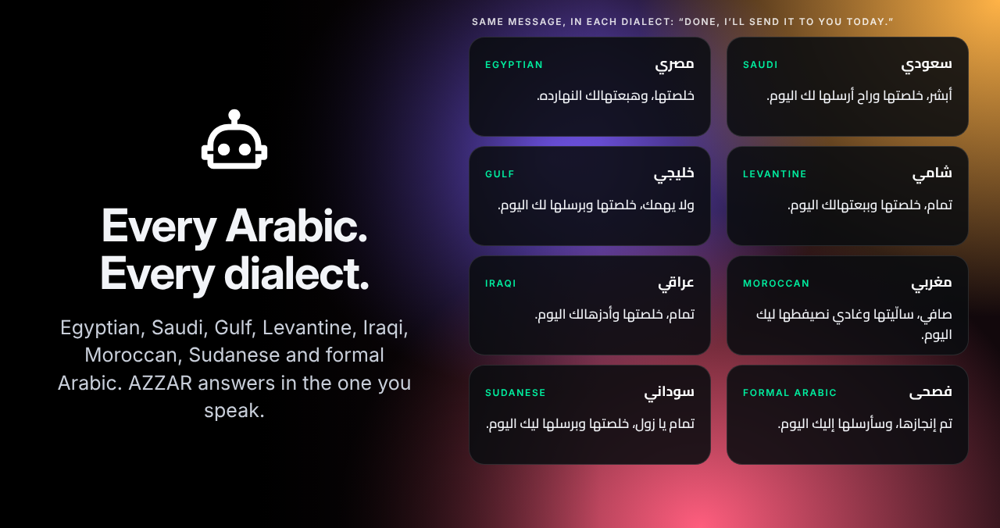
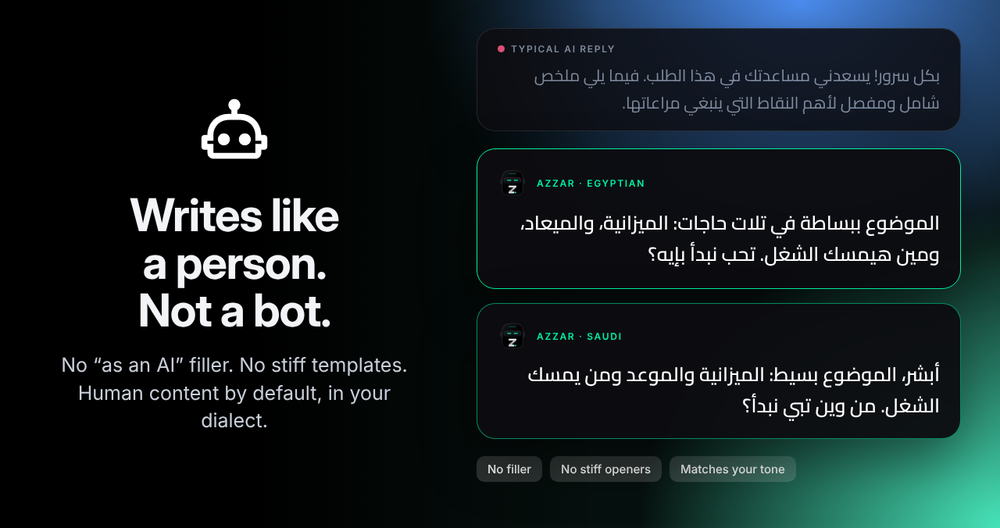
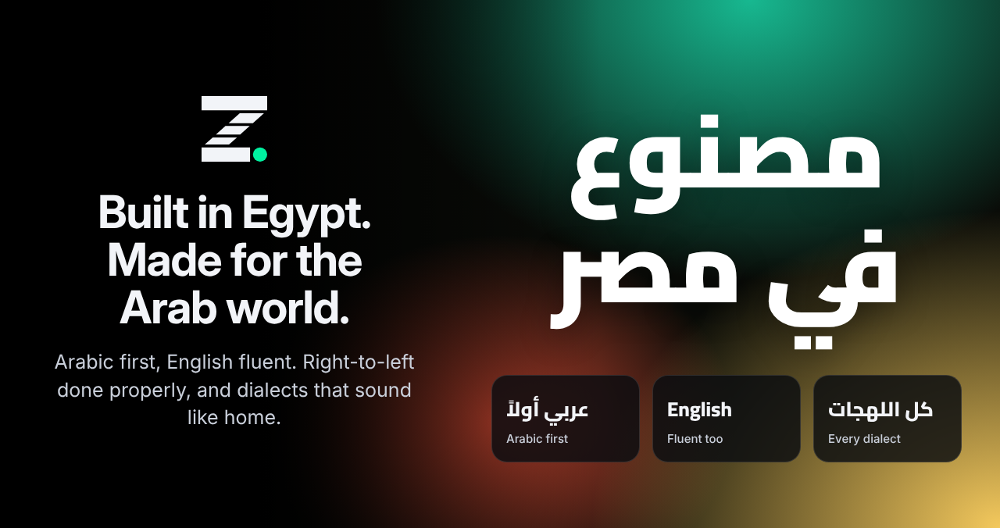

<picture>
  <source media="(prefers-color-scheme: dark)" srcset="docs/assets/azzar-lockup-horizontal-primary-on-dark.png">
  
</picture>

# AZZAR

**Your chief agent orchestrator.**

Most AI apps are chat windows. You ask, it answers, and the work is still yours.
AZZAR is built on a different idea: you delegate, it operates.

Give it a mission. It plans the work, assigns the right agents to each part,
and reports back when it is done. The unit of work is the mission, not the
message. You stay in charge, without staying online.

**English** · **Arabic** · [Website](https://hazemelerefy.tech) · [Issues](https://github.com/hazemelerefey/azzar-agent/issues) · [License](./LICENSE)

<kbd>Table of contents</kbd>

- [Getting started](#getting-started)
- [Agents](#agents)
- [Features](#features)
- [How it differs](#how-it-differs)
- [Your rules, your control](#your-rules-your-control)
- [Self hosting](#self-hosting)
- [Local development](#local-development)
- [Contributing](#contributing)
- [License](#license)

## Getting started

AZZAR is the Chief Agent Orchestrator for your company, and for you. It runs
departments of AI agents the way a real organization runs: every department
has a manager agent, and every manager builds temporary specialist subagents
for the specific roles underneath it.

The marketing manager spins up a content specialist to write and design the
week's social posts, and an SEO specialist to own search. HR, operations,
every department works the same way: one expert manager per department,
specialists per role, all reporting up to AZZAR.

One orchestrator. Eight managers. One result.

## Agents

### Orchestrator

**AZZAR, Chief Agent Orchestrator.** Takes your mission, splits it into
department jobs, assigns, watches, and delivers. It delegates, never does
the job itself. The right department does the work. It checks quality and
resolves conflicts between departments. It reports in plain language. It is
the only agent you talk to.

### Department managers

| Agent | Manager title | Mission |
|---|---|---|
| Human Resources | People manager | Build and keep the team that does the work. |
| Accounting & Finance | Money manager | Know where every unit of money comes from and goes. |
| Marketing | Growth & brand manager | Make the right people know it, trust it, want it. |
| Sales | Revenue manager | Turn leads into customers, cleanly and honestly. |
| Operations | Execution manager | Make the work happen, on time, without waste. |
| Customer Support | Customer manager | Keep customers helped, heard, and kept. |
| Legal & Compliance | Protection manager | Keep the company protected, before problems happen. |
| Information Technology | Technology manager | Keep technology working, safe, and ready. |

### Specialist subagents, on demand

Each manager spawns temporary specialists for its roles, then closes them
when the job is done. Each subagent wears its parent department color.

- **Human Resources, 6:** Hiring, Onboarding, Benefits, Training, Reviews, Culture
- **Accounting & Finance, 5:** Bookkeeping, Payroll, Budgeting, Tax, Forecasting
- **Marketing, 4:** Research, Brand, Campaigns, Lead Generation
- **Sales, 4:** Lead Conversion, Deal Closing, Pipeline, Revenue
- **Operations, 4:** Processes, Supply Chain, Logistics, Resource Allocation
- **Customer Support, 4:** Troubleshooting, Questions, Retention, Satisfaction
- **Legal & Compliance, 4:** Contracts, Intellectual Property, Regulation, Risk
- **Information Technology, 5:** Hardware, Software, Networks, Helpdesk, Security

Departments are isolated, so load on one does not affect another.

## Features

### One mission, a whole team

You delegate the mission. AZZAR operates it. Example mission: cut monthly
costs by 10 percent. Marketing, Sales, Operations, Legal, and Support work
it, and you get one finished plan, not five chats.

### Any model, your rules

Pick the model for each department, bring your own keys, and change them
any time. HR can run a fast model, Accounting a reasoning model, Legal the
most careful model, IT a coding model. Model per department, not one model
for everything.

### Multi AI providers

OpenAI, Anthropic, Google, Mistral, Meta, Ollama, and more. Connect the ones
you use and switch any time. Provider logos are the property of their
owners, shown only to indicate supported providers.

### Visual recognition

Send an image, a screenshot, or a scanned page. The right department reads
it and acts. Photo read, caption and alt text written, for example for a
menu page.

### Agents Market

Add ready department agents when you need them. No forced subscription.
Departments come ready-made. Pick one as your department manager and it
adapts to your company, not a template company. It learns your voice, your
brand, your rules, and does the job of the role from day one.

Better output, lower labor cost. That is the trade, and it is the whole point.

### Every Arabic, every dialect

Egyptian, Saudi, Gulf, Levantine, Iraqi, Moroccan, Sudanese, and formal
Arabic. AZZAR answers in the one you speak. Arabic first, English fluent.

### Writes like a person, not a bot

No "as an AI" filler. No stiff templates. Human content by default, in your
dialect, matching your tone.

### Built in Egypt, made for the Arab world

Arabic first, English fluent. Right-to-left done properly, and dialects
that sound like home. Built in Egypt.

## How it differs

A chat assistant waits for your next message. AZZAR works the mission:

**Delegation, not conversation.** You hand over a goal, not a prompt.

**An operation, not a window.** Agents run on schedule and on trigger,
with or without you watching.

**Departments, not plugins.** Standing teams with real jobs and real
managers, not a drawer of disconnected tools.

## Your rules, your control

The company manager sets the rules for every department and every employee:

**Where agents run.** On each employee's device, or locked to the company
server. Your call, per department.

**Which model.** Bring your own keys, pick per department, or strict-lock a
department to one specific model.

**What they can touch.** Permissions per department, per role, per tool.
Nothing runs outside the lines you draw.

No forced subscriptions. No renewing a seat license to keep your own
operation alive. You control the models, the machines, and the money.

## For individuals

One person gets the same power. AZZAR is your own chief of staff: it runs
your missions across every surface you work on, desktop, mobile, and web,
and reports back when the work is done.

## Self hosting

See [docs/self-hosting/start.mdx](./docs/self-hosting/start.mdx) for the
full self hosting guide, including environment variables and Docker setup.
This repo includes a `Dockerfile` and `docker-compose/` for local and
server deployment. Do not use any other deploy button or hosting link
from older README versions, they were not AZZAR's.

## Local development

See [CONTRIBUTING.md](./CONTRIBUTING.md) and the docs in `./docs/` for
local development, including the development guide in
`./docs/development/`. Packages live in `./packages/`, under the `@azzar`
scope.

## Where this goes

1. **Department marketplace.** Ready managers for every standard department,
   installable in one step.
2. **Rules console.** The full control surface: models, machines,
   permissions, per department and per role.
3. **Missions.** Goal-based delegation as the front door. You assign
   outcomes; AZZAR staffs and runs them.
4. **True 7x24.** Departments working on schedule while you are offline,
   with reporting you read when you return.

## Screenshots

Captured from the real application. No mockups. Screenshots are added when
the app runs, they are not in this README yet, and no marketing card above
is presented as a screenshot. Marketing cards are illustrative feature
cards, not captured from the app.

## Contributing

See [CONTRIBUTING.md](./CONTRIBUTING.md). Feedback and issues are welcome
at [https://github.com/hazemelerefey/azzar-agent/issues](https://github.com/hazemelerefey/azzar-agent/issues).

## License

AZZAR is licensed under the AZZAR Community License. See
[LICENSE](./LICENSE) for the full terms. For commercial licensing
questions, contact hello@hazemelerefy.tech, as stated in the LICENSE file.

---
